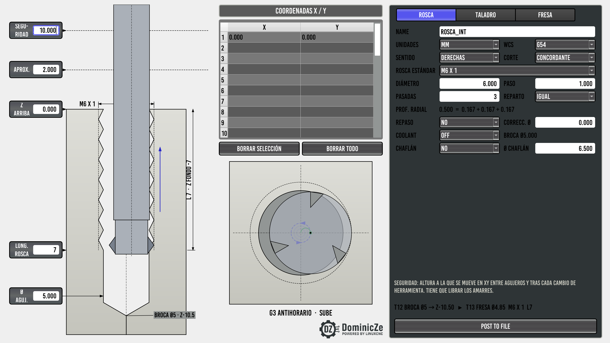
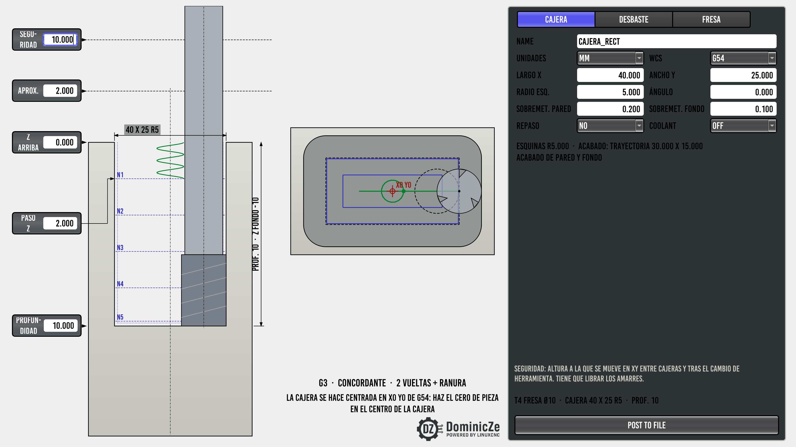
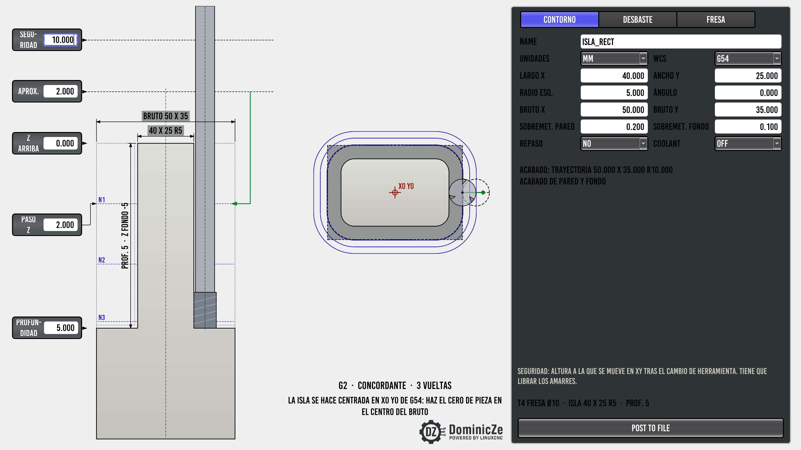

# PB_Conversational

Conversational screens and G-code generators for **Probe Basic** (LinuxCNC, mill).

I built this for my own shop machines because I got tired of firing up full CAM software just to mill a thread, clean out a centered pocket, or tweak axis backlash in the `.ini` file. Nothing in it modifies Probe Basic's own files: it installs as a standard user tab (`user_tabs/pb_conversational/`) that, on startup, plugs each screen into its natural spot inside **CONVERSATIONAL** and **SETTINGS**. If a Probe Basic variant doesn't have one of those slots, the screens stay together in a normal user tab (`CONVERSATIONAL+`).

<p align="center">
  
  
  
</p>

*(Screenshots above are from my own shop machine running the original Spanish layout; this release translates all screen labels, tooltips, and G-code comments into English.)*

## What's included

- **CONVERSATIONAL > HOLE OPS**
  - **INT. THREAD**: optional peck drilling (full retract to the R-plane on each peck) and internal thread milling for metric (M1.6 to M64) or UNC/UNF (#0 to 2") threads across an X/Y coordinate table.
  - **EXT. THREAD**: external thread milling on a cylinder centered at X/Y.
- **CONVERSATIONAL > POCKETS**
  - **RECT. POCKET**: rectangular pocket centered at `X0 Y0`, with corner radius, rotation angle, multi-pass roughing, helical or ramp entry, and wall/floor finishing passes.
  - **CIRC. POCKET**: circular pocket centered at `X0 Y0`.
- **CONVERSATIONAL > PERIMETER**
  - **RECT. CONTOUR**: external contouring leaving a rectangular island (with corner radius and rotation angle) centered at `X0 Y0`, plunging outside the stock.
  - **CIRC. CONTOUR**: external contouring leaving a circular island centered at `X0 Y0`.
- **SETTINGS**
  - **BACKLASH COMPENSATION**: adjust `BACKLASH` per axis directly from the UI without manually editing the `.ini` file, plus a dial-indicator measurement helper.

## Compatibility and requirements

- **Probe Basic 0.6.x** (Debian 12 Bookworm, PyQt5).
- **Probe Basic 1.0.x** (Debian 13 Trixie, PySide6).
- **Mill configurations only** (`probe_basic_lathe` is not supported).
- Needs no `sudo` and no external dependencies: it uses the `python3` environment already bundled with Probe Basic (`qtpy`).
- **Tool Table (`tool.tbl`)**: make sure any tools you reference by `TOOL NUMBER` exist in LinuxCNC's Tool Table. Missing tools are flagged in red (`TOOL NOT IN TOOL TABLE`) because LinuxCNC will reject `M6 T<n>`.

> **Safety notice:** Always inspect generated `.ngc` toolpaths in the LinuxCNC backplot and run an air cut before machining real stock.

## Installation (automatic)

### Option A: Single `.run` package

Copy `dist/pb_conversational_1.5.0.run` to your LinuxCNC machine and run:

```bash
bash pb_conversational_1.5.0.run
```

The installer scans `~/linuxcnc/configs` for Probe Basic mill configurations (if there are several, it asks which one you want) and sets everything up. Restart Probe Basic when finished.

Other commands:

```bash
bash pb_conversational_1.5.0.run install /path/to/your_machine.ini
bash pb_conversational_1.5.0.run install --set-aside-templates   # hides empty example USER tabs
bash pb_conversational_1.5.0.run status  [/path/to/your_machine.ini]
bash pb_conversational_1.5.0.run uninstall [/path/to/your_machine.ini]
bash pb_conversational_1.5.0.run --extract [FOLDER]              # extract files only
```

### Option B: From a git checkout

```bash
python3 installer/pb_conversational_installer.py install
```

Or pass the `.ini` path directly:

```bash
python3 installer/pb_conversational_installer.py install ~/linuxcnc/configs/MY_MACHINE/my_machine.ini
```

### What the installer changes

1. Saves a backup of your `.ini` in `<config>/.pb_conversational/<ini_name>/ini_original.ini`.
2. In `[DISPLAY]`, enables `USER_TABS_PATH = user_tabs/` (if not already active), adds the trailing `/` if missing (Probe Basic needs it), and moves any inline `#` comment to its own line so LinuxCNC doesn't choke on it.
3. If `USER_TABS_PATH` wasn't active before and empty example templates (`template_main`, `template_sidebar`) sit in `user_tabs/`, it moves them aside so blank tabs don't show up.
4. Copies `pb_conversational/` into `user_tabs/pb_conversational/`. On updates, your saved screen parameters (`last_*.json`) are kept.

Running `uninstall` reverses all changes to the `.ini` and `user_tabs/` without touching any `.ngc` files you generated.

## Manual installation

1. Copy `pb_conversational/` into your machine config's `user_tabs/` folder:
   ```text
   ~/linuxcnc/configs/YOUR_MACHINE/user_tabs/pb_conversational/
   ```
2. In your `.ini` file under `[DISPLAY]`, add:
   ```ini
   USER_TABS_PATH = user_tabs/
   ```
   Make sure the trailing `/` is there and there is no `#` comment on that same line.
3. Remove or move unused example folders (`template_main`, `template_sidebar`) from `user_tabs/`.
4. Restart Probe Basic.

## Rebuilding the `.run` package

If you modify a screen or G-code generator and want to rebuild the single-file installer:

```bash
python3 installer/build_package.py
```

This writes `dist/pb_conversational_<version>.run`.

## Project layout

```text
PB_Conversational/
├── pb_conversational/                # Probe Basic user tab
│   ├── pb_conversational.py          # Entry point and thread milling screens
│   ├── conv_common.py                # Shared base classes, Qt styles, and G-code helpers
│   ├── thread_mill_gen.py            # Thread milling and peck drilling G-code generator
│   ├── thread_sketch.py              # Thread milling schematic sketch
│   ├── pocket_gen.py                 # Rectangular/circular pocket G-code generator
│   ├── pocket_page.py                # Pocket screens
│   ├── pocket_sketch.py              # Pocket and contour schematic sketch
│   ├── contour_gen.py                # Rectangular/circular island contour G-code generator
│   ├── contour_page.py               # Contour screens
│   ├── backlash.py                   # Backlash compensation screen
│   ├── backlash_ini.py               # Safe .ini BACKLASH reader/writer
│   └── logo_dz_oscuro.png            # Logo
├── installer/
│   ├── pb_conversational_installer.py
│   └── build_package.py
├── dist/
│   └── pb_conversational_1.5.0.run
├── docs/
│   ├── ARCHITECTURE.md
│   ├── BACKLASH_COMPENSATION.md
│   ├── INSTALLER_AND_FILES.md
│   ├── OPERATIONS.md
│   ├── PROBE_BASIC_INTEGRATION.md
│   └── images/
├── LICENSE
└── README.md
```

## Further reading

If you want to dig into how the G-code math, runtime tab docking, or `.ini` parser work under the hood:

- [Shop guide to the conversational operations](docs/OPERATIONS.md): machining notes on thread milling (climb direction, decreasing pass depth, tool-center feed compensation, BB cutters), pockets, and island contours.
- [How it hooks into Probe Basic and LinuxCNC](docs/PROBE_BASIC_INTEGRATION.md): `USER_TABS_PATH` pitfalls, runtime docking into Probe Basic's tabs, Tool Table (`tool.tbl`) lookup, and PyQt5/PySide6 (`qtpy`) compatibility.
- [Backlash compensation panel](docs/BACKLASH_COMPENSATION.md): reading/writing `[JOINT_n] BACKLASH`, automatic `.ini` backups, Mesa/stepgen `STEPGEN_MAXACCEL` headroom warning, and measuring lost motion with a dial indicator.
- [How the installer works](docs/INSTALLER_AND_FILES.md): what `install` and `uninstall` touch on disk and how the `.ini` backup/restore works.
- [Code structure and module notes](docs/ARCHITECTURE.md): how the pure-Python G-code generators, `QPainter` sketches, and Qt screens fit together.

## Author and license

Written by **Raúl Milla (DominicZe)**
- Website: https://dominicze.com
- YouTube: https://www.youtube.com/@DominicZe

Released under the [MIT License](LICENSE), Copyright (c) 2026 Raúl Milla (DominicZe).
