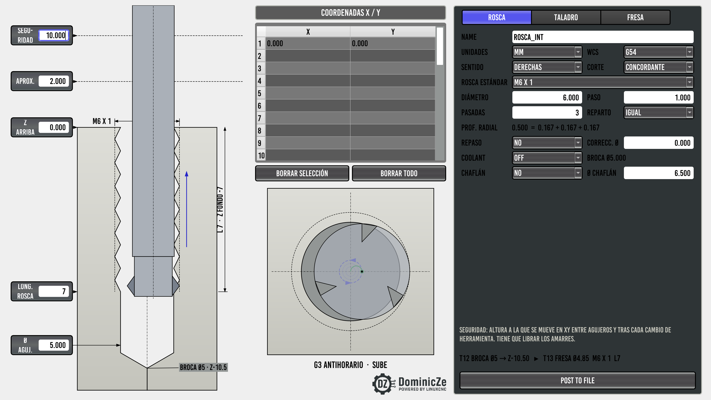
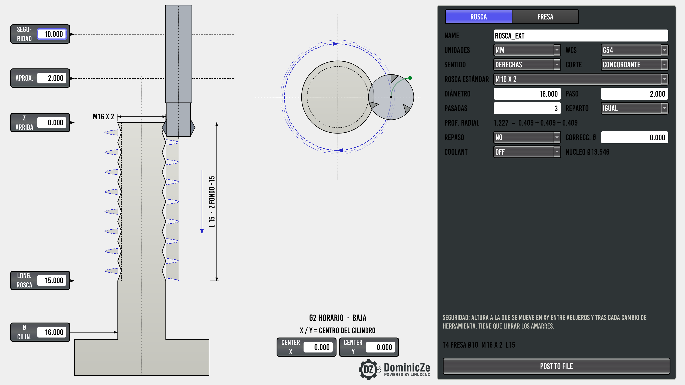
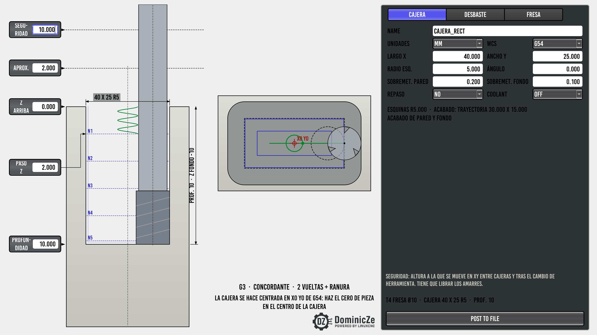
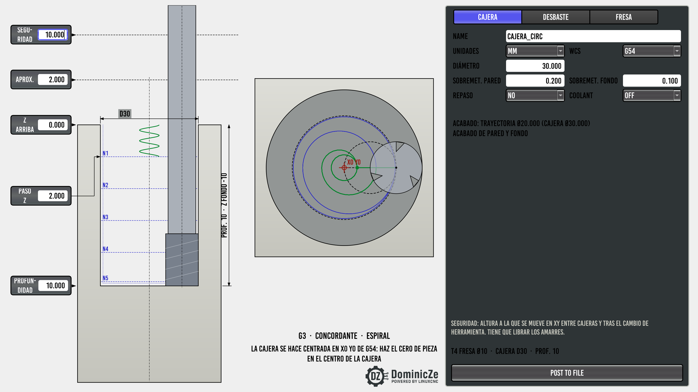
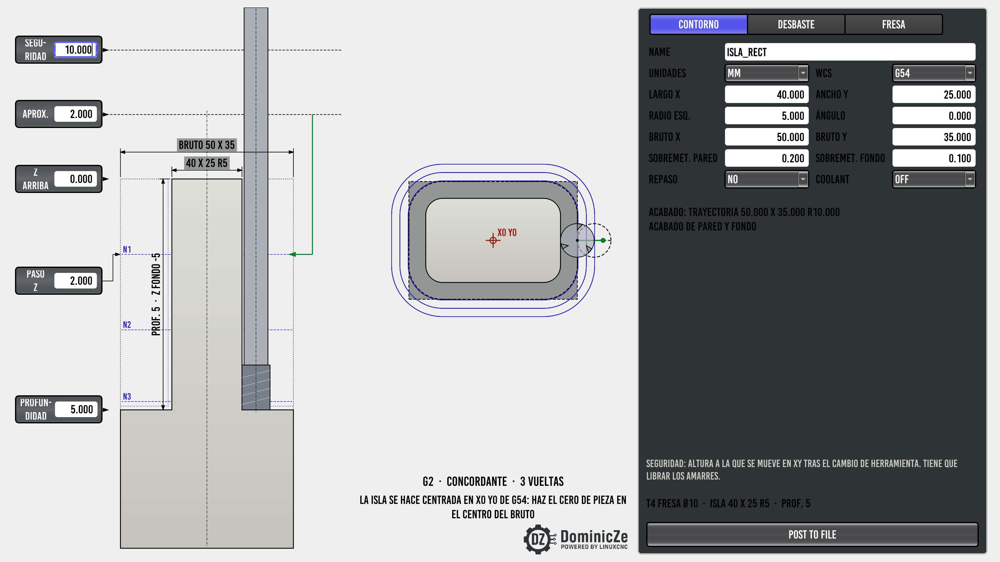
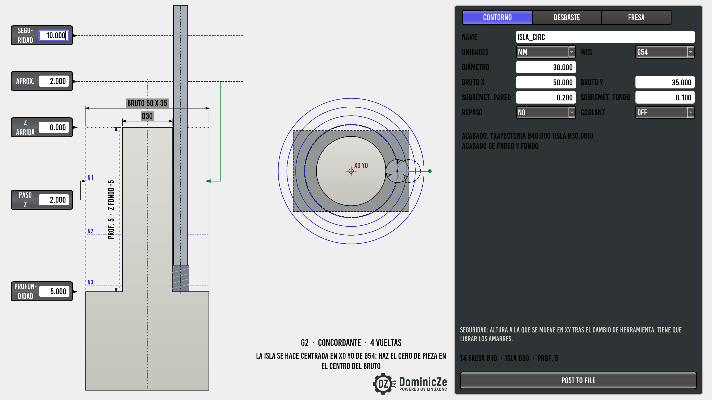

# Shop guide to the conversational operations

Here is how each screen works in practice at the machine, along with a few machining notes on why the toolpaths are set up the way they are.

*(The screenshots below were taken on my own machine running the original Spanish labels; in this release all UI strings, tooltips, and G-code comments are in English.)*

## Thread milling (`CONVERSATIONAL > HOLE OPS`)

  
  

Thread milling is easily one of the most useful things you can do on a CNC mill - one single-form cutter can cut right-hand, left-hand, blind-hole, or oddball threads across a range of diameters without risking a snapped tap at the bottom of a part. The catch is that calculating tool-center compensation, radial pass depths, and helical tangential lead-in by hand at the control is tedious.

### Internal threads (`INT. THREAD`)

On the middle column you have a 30-row X/Y coordinate table so you can drill and thread a whole bolt pattern in one program.

If **PRE-DRILL** is set to `YES` in the `DRILL` tab, the program starts with the twist drill (`T.. M6`), peck-drills every coordinate in the table, and then switches to the thread mill. Instead of relying on a canned cycle where chip clearing depends on controller parameters, the generator emits explicit peck moves with full retract to the `APPROACH` R-plane on every peck, rapid re-entry stopping `REENTRY` clearance above the previous bottom, decreasing peck depth (`FIRST PECK`, `REDUCTION`, `MIN PECK`), and an optional bottom dwell. By default, cylindrical drill depth is auto-calculated from your thread length + tip-to-tooth offset + 2 pitches (rounded up to `0.5 mm` / `0.02 in`), accounting for the drill's point angle (`118°` / `135°`) so the full diameter reaches below the thread mill tip. If you type a custom depth, it stays manual until you clear the box.

In the `THREAD` tab you can pick any standard metric coarse/fine thread (`M1.6` to `M64`) or Unified inch thread (`#0` to `2"` UNC/UNF), or select `CUSTOM` for non-standard pitches. Choosing a preset automatically fills nominal diameter, pitch (or TPI in `IN` mode), and the standard tap drill size.

A few practical details worth noting:
- **Climb vs. conventional:** With the spindle running clockwise (`M3`), climb-milling an internal right-hand thread means helixing **from the bottom up** in `G3` (CCW). That's almost always what you want - chips fall below the cutter instead of getting recut, and tool deflection pushes away from the thread root.
- **Radial passes (`EQUAL` vs `DECREASING`):** Just like single-point threading on a lathe, taking constant radial step-downs makes each pass engage a wider V-flank than the previous one. `DECREASING` scales radial steps by $\sqrt{i/n}$ (roughly constant chip cross-section) so the final pass is light, and you can add a zero-DOC `SPRING PASS` if the tool has a long slender neck.
- **Fit adjustment (`DIA. OFFSET`):** Carbides deflect and cutters wear. Instead of lying about the cutter diameter to get a thread gauge or bolt to fit, leave `CUTTER Ø` at the actual measured crest diameter of your tool and tweak `DIA. OFFSET` by `+0.02` or `+0.05 mm` until your go/no-go plug gauge feels right.
- **Mouth chamfer (`CHAMFER`):** If your single-form thread mill has a small flat/cone below the lowest tooth (`TIP-TOOTH > 0`), enabling `CHAMFER` uses the lower 60° flank of the tooth to interpolate a 120° countersink at the top of the hole before retracting.
- **BB catalog button (`USE BB`):** In the `ENDMILL` tab, clicking `USE BB` looks up the thread in the built-in BB (`BK2055` / `BF2055`) single-tooth carbide thread mill table and fills in crest diameter, flute count, and usable neck reach (`REACH`), warning you if your thread depth exceeds the tool's relieved neck length.
- **Tool-center feedrate:** When you enter `FZ` (chip load per tooth), the generator computes the peripheral cutting-edge feedrate and scales it down to the tool-center path radius (`F_center = F_edge * R_center / R_major`) so you don't accidentally feed the tooth tips at 2x or 3x the intended chip load inside a small bore.
- **Lead-in / lead-out (`LEAD FEED %`):** Every radial pass enters and leaves the thread on a tangential arc, but on that arc the cutting edge at the contact point travels on a bigger radius than the tool center (lead arc radius + cutter radius). Feeding the lead arc at the helix feedrate meant the tooth hit the wall at 1.6x to 3x the programmed edge feed, right when it was loading up. The lead arcs now get their own feedrate, referred to the edge at the contact point (`F_lead = F_edge * LEAD% * R_lead / (R_lead + R_cutter)`, 50% by default, set in the `ENDMILL` tab), and the helix feed is restored as soon as the tooth is on the thread. The same rule applies to the chamfer lead arcs.

### External threads (`EXT. THREAD`)

Works the same way on a boss or stud centered at `CENTER X` / `CENTER Y`. The cutter rapids to a safe clearance point outside the cylinder OD, feeds down to start height, arcs tangentially into the thread flank, spirals around the boss (`G2` CW going down for climb milling a right-hand thread with `M3`), and arcs tangentially clear before retracting.

The external lead arc is a quarter circle with its radius sized from the thread depth + clearance gap + cutter radius, so the tooth swings in gently instead of turning tight around the crest. Its Z travel matches the angle it actually sweeps around the thread axis (about 1/12 to 1/8 of a pitch for typical sizes), so the tooth follows the thread lead on the way in and out. On internal threads the semicircle from the hole center sweeps a quarter turn around the axis, so the 1/4 pitch it climbs was already right.

---

## Pockets (`CONVERSATIONAL > POCKETS`)

  
  

Both `RECT. POCKET` and `CIRC. POCKET` are always centered at **`X0 Y0`** in your active WCS (`G54`..`G59.3`). When I need a quick bearing pocket or a counterbore slot at the mill, I find it much faster and less error-prone to probe or edge-find the center of the feature as `X0 Y0` than to mentally offset from a corner.

For entry into solid stock, `HELIX` spirals down at the center at your chosen `RAMP ANGLE` (2°–3° works well in steel, 3°–5° in aluminum) using the reduced `ENTRY FEED %`. If a rectangular pocket is too narrow for a helix, it automatically drops back to a zig-zag center `RAMP` along the long axis (or you can choose `PLUNGE` if you already pre-drilled a starter hole).

Once at depth on each Z level, clearing works strictly from the center outward in one consistent direction (`CLIMB` = `G3` CCW inside a pocket) with stepover capped at 70% of cutter diameter so no uncut triangles are left in the corners. If you specify `WALL STOCK` or `FLOOR STOCK`, roughing leaves that material and finishes the floor and full-depth wall at the end (using a tangential arc lead-in/lead-out on the wall, plus an optional `SPRING PASS`).

Going from one roughing loop to the next, the rectangular pocket no longer steps straight out into the wall and turns a 90° corner: the loop stops one stepover short and an S-curve of two tangent quarter arcs carries the cutter onto the next loop, at `ENTRY FEED %`, so it loads up gradually. Circular pockets already spiral out on tangent half-turns. The wall-finish lead arcs also run at `ENTRY FEED %`, referred to the cutting edge at the contact point, because on a lead arc the edge travels on twice the radius of the tool center and would otherwise hit the wall at about 2x the finishing feed.

---

## External island contouring (`CONVERSATIONAL > PERIMETER`)

  
  

`RECT. CONTOUR` and `CIRC. CONTOUR` are the inverse of the pocket screens: you touch off `X0 Y0` at the center of your raw stock block (`STOCK X` x `STOCK Y`), tell it the finished rectangular or circular boss (`ISLAND`) you want left standing in the middle (with corner radius and rotation angle if rectangular), and it clears away all the surrounding stock down to `DEPTH`.

Because it plunges outside the stock boundary (25% of cutter diameter clear of the stock edge) and steps inward in concentric loops (`G2` CW for outside climb milling), **make sure your stock sticks up above the vise jaws by more than `DEPTH`**.

The loops are joined tangentially, the same as in the pockets: an S-curve between rectangular loops, and a half-turn whose radius shrinks from one circle to the next on circular islands. The wall-finish lead arcs use `ENTRY FEED %` referred to the cutting edge.

---

## Backlash compensation (`SETTINGS`)

Lets you check, measure, toggle, and save `[JOINT_n] BACKLASH` per axis right from the `SETTINGS` tab with automatic `.ini` backups and a step-by-step dial-indicator guide. See [Backlash compensation details](BACKLASH_COMPENSATION.md) for the full rundown.
